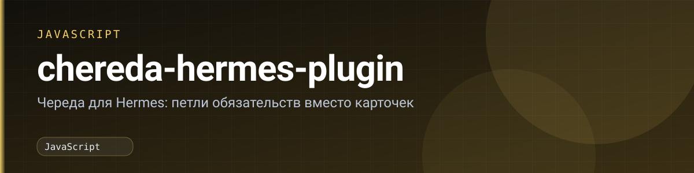

<div align="center">



# Череда для Hermes

### Череда для Hermes: петли обязательств вместо карточек

[](https://github.com/kostyk348/chereda-hermes-plugin/releases)
[](https://github.com/kostyk348/chereda-hermes-plugin/blob/main/LICENSE)
[](https://github.com/kostyk348/chereda-hermes-plugin)

</div>

---


Петли обязательств вместо карточек: у каждой петли видно **чей ход**, сколько
осталось до срока и чем дело доказано. Глаголы — `просить`, `обещать`, `сделать`,
`принять`, `возразить` — кнопками в приложении, а правила остаются в одном месте,
в самом CLI `череда`.

Плагин — тонкая оболочка. Он не хранит состояние и не решает за Череда: каждый
запрос из интерфейса превращается в вызов `череда … --ledger <среда>`, поэтому
«не в свой ход не говорят», «отказ только с причиной» и предел трём обещаниям
работают одинаково и из терминала, и из кнопки.

## English

**Chereda for Hermes: obligation loops instead of cards.** Each loop shows **whose move** it is, how long is
left before the deadline, and what proves the work was done. The move verbs — `просить`, `обещать`, `сделать`,
`принять`, `возразить` — are buttons in the app, while the rules stay in one place: the `chereda` CLI.

The plugin is a thin shell: it keeps no state and decides nothing on Chereda's behalf. Every request becomes a
call to `chereda … --ledger <environment>`, so "you do not speak out of turn", "a refusal needs a reason" and the
three-promises limit behave the same from a terminal and from a button.

### Requirements

1. **The `chereda` binary in `PATH`** — from the [Chereda repository](https://github.com/kostyk348/chereda):

   ```sh
   cargo install --path .
   череда --help
   ```

   Without it the plugin answers `503` with a hint instead of showing an empty screen. Set `CHEREDA_BIN` to point
   at a binary outside `PATH`.

2. **Hermes with the plugin enabled** — `plugins.enabled` in `config.yaml`.

### Environment

`CHEREDA_LEDGER` — the loop store (default `~/.chereda`); `CHEREDA_BIN` — the binary path. The dashboard and the
bridge both look the binary up the same way: `CHEREDA_BIN`, then `череда`/`chereda` in `PATH`.

### What runs commands on your machine (disclosure)

- The dashboard backend runs **no** commands of its own: it only execs the `chereda` CLI with an argument list
  (never through a shell) and returns what the CLI printed.
- **`сделать` (done) with a proof does run a command on the host as the user**: Chereda executes the `--proof`
  string through `sh -c` and stores a fingerprint of its output. The UI passes the verb and the proof that a human
  typed; it does not invent commands.
- The optional bridge (`tools/chereda_bridge.py`) replays proofs found in worker reports — but **only** commands
  listed in `.bridge-allow.txt`. Without that file nothing is replayed; an unapproved proof lands in the loop
  feed as "waiting for the owner's approval". A prefix entry ending in `*` matches by word boundary and never
  matches a string containing `;`, `|`, `&`, `$`, a backtick, `>` or `<`.

### Tests

```sh
python3 -m unittest discover -s tests -v
```

MIT.

## Что нужно

1. **Бинарь `череда` в `PATH`** — из репозитория [Череда](https://github.com/kostyk348/chereda):

   ```sh
   cargo install --path .
   череда --help
   ```

   Если бинаря нет, плагин честно отвечает `503` и пишет, чего не хватает, — а не
   показывает пустой экран.

2. **Hermes с включённым плагином**: `plugins.enabled` в `config.yaml` должен
   содержать `chereda`, затем перезапуск шлюза (⌘K → «Перезапустить шлюз»).
   Без бэкенда панель скажет, что он не подключён.

## Что появляется в приложении

* строка **«Череда»** в боковом меню (сразу под «Запланированными задачами») и
  команда `Череда: петли` в ⌘K;
* страница с петлями: дело, **ход** (`ход заказчика` / `делающего`), слово за кем,
  состояние, часы и срок, класс, заказчик → делающий, просрочка и эскалация;
* **описание** целиком (сколько символов — видно в заголовке секции, есть
  «свернуть/развернуть»);
* **доказательство**: команда, отпечаток вывода, ожидаемый код, первые строки;
* **история ходов**: кто, когда, что сделал и с какой заметкой;
* **лента**: отчёты и вопросы участников, поле «сказать» — лента **не двигает
  ход**, ход меняют только глаголы;
* **правка описания** прямо в карточке (правит участник петли, пустым не затирается);
* кнопки хода: `обещать` / `отказать` / `сделать` / `принять` / `возразить` / `снять`
  и `проверить реальность`.

## Среда (где лежат петли)

По умолчанию `~/.chereda`; переопределяется переменной `CHEREDA_LEDGER`.
Путь к бинарю можно задать явно: `CHEREDA_BIN`.

## Связь с очередью воркеров

Плагин — только про чтение и ходы. Мост «петля → карточка воркеру → отчёт в
ленту» живёт отдельным скриптом (`tools/chereda_bridge.py`): он заводит карточку
делающему, а когда она закрыта — кладёт отчёт в ленту и проигрывает найденное
`ДОКАЗАТЕЛЬСТВО: <команда>` через `череда сделать`. Без моста петли придётся
двигать руками — это нормальный режим, просто медленнее.

## Границы

* Плагин ничего не публикует и не пушит. Но **`сделать` с доказательством
  выполняет команду на хосте от имени пользователя**: Череда запускает строку
  `--proof` через `sh -c` и записывает отпечаток вывода. Интерфейс сам команды не
  придумывает — он передаёт то, что нажал человек, — однако кнопка `сделать` это
  запуск команды, а не безобидная запись в журнал.
* Мост (`tools/chereda_bridge.py`) проигрывает доказательство **только** если
  команда есть в `.bridge-allow.txt`; префиксная запись `*` не пропускает строки
  с `;`, `|`, `&`, `$`, обратными кавычками, `>` и `<`. Файла нет — не выполняется
  ничего, доказательство уходит в ленту как «ждёт разрешения».
* Все запросы — через шлюз Hermes на loopback; наружу плагин не ходит.
* Самообновления внутри плагина нет — обновление только новой версией в каталоге.

## Лицензия

MIT.
